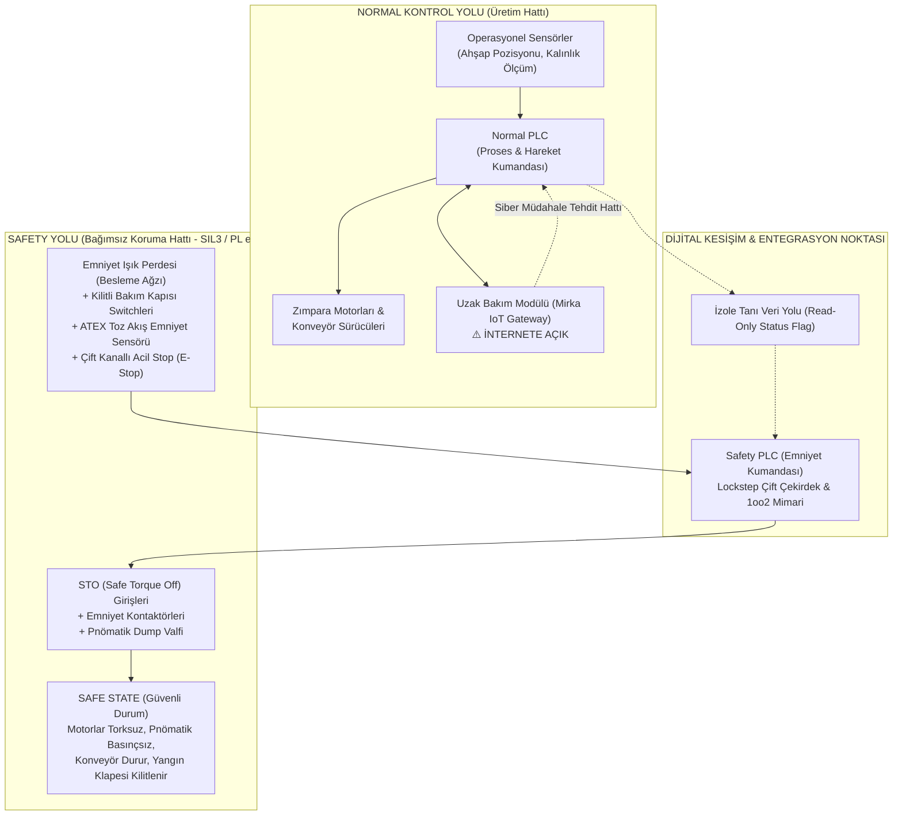

# 🛠️ Laboratuvar 1: Safety Architecture (Emniyet Mimarisi)
**Ders:** Yazılım Mühendisliğinde Güncel Konular (Safety 4.0 & Cyber-Physical Systems)  
**Şirket:** Mirka (Oy Mirka Ab)  
**İncelenen Makine:** Mirka Smart WoodSander 5000 — Endüstriyel Otomatik Ahşap Kalibre & Zımpara Makinesi  
**Çıktı Belgesi:** Safety Function Map *(Evidence Pack EP 03 Safety Functions)*  
**Tarih / Versiyon:** 2026-Q4 / v1.0  

---

## 📌 1. Makine Bağlamı ve Operasyonel Tanım

Mirka Smart WoodSander 5000, endüstriyel mobilya ve ahşap panel üretiminde yüksek hassasiyetli yüzey işleme sağlayan tam otomatik bir zımpara hücresidir. 

* **Mekanik Tehlike Kaynakları:**
  * **Yüksek Devirli Zımpara Üniteleri:** 4.000 – 10.000 RPM dönme hızına sahip geniş bant ve orbital zımpara diskleri (Mirka AIROS robotik kafalar).
  * **Besleme Mekanizması:** Yüksek torklu konveyör bant ve ağır pnömatik baskı merdaneleri (ahşabı sabit tutmak için 6–8 bar pnömatik kuvvet).
  * **Toz ve Patlama Riski:** Ahşap talaşı ve yanıcı toz partiküllerinin oluşturduğu patlayıcı atmosfer (ATEX Zone 22) ve sürtünme ısısıyla tutuşma riski.
* **Dijital & Haberleşme Altyapısı:**
  * **Normal Kontrol Yolu:** Endüstriyel PLC (Üretim parametreleri, hız, zımpara baskı kuvveti, konveyör besleme).
  * **Emniyet Kontrol Yolu (Safety Path):** SIL 3 / PL e sertifikalı Emniyet PLC'si (Safety PLC), emniyet ışık perdeleri, çift kanallı kilitli kapı anahtarları, pnömatik basınç boşaltma valfleri, STO (Safe Torque Off) sürücüler.
  * **Ağ ve Uzak Bağlantı:** Mirka Cloud Telematics / IoT Ağ Geçidi (Aşınma analizi, kestirimci bakım, internete doğrudan açık servis modülü).

---

## 📐 2. Kontrol ve Emniyet Mimari Şeması

---

## 📝 3. Laboratuvar Görev Soruları ve Uzman Yanıtları

### 1. Bu makinede tehlike nedir? İnsan neyden zarar görür?
* **Ağır Sürtünme ve Uzuv Parçalanması:** 10.000 RPM hızla dönen elmas/seramik aşındırıcı zımpara kafalarına temas eden el ve kollar saniyeler içinde kemiğe kadar aşınır veya parçalanır.
* **Pnömatik Baskı ve Konveyör Sıkışması:** Kalibre merdanelerinin altına veya besleme bandı ile baskı ruloları arasına el kaptırılması durumunda kemik kırılması, ezilme ve uzuv kopması meydana gelir.
* **ATEX Yangın ve Toz Patlaması:** Yanıcı ahşap tozu birikintisinin sürtünmeden kaynaklanan sıcaklık (kıvılcım) ile birleşmesi sonucu atölye çapında yıkıcı toz patlaması ve ağır termal yanıklar.
* **Yüksek Hızlı Parça Fırlaması:** Zımpara bandının kopması veya hatalı reçete ile ahşabın aşırı sıkıştırılıp kırılması neticesinde fırlayan şarapnel etkili ahşap/zımpara parçaları.

---

### 2. Safety Function (Emniyet Fonksiyonu) hangisidir?
Mirka WoodSander 5000 üzerinde tanımlanan kritik emniyet fonksiyonları:
1. **SF-01 (Besleme Ağzı Optik Koruma):** Operatörün eli besleme ağzındaki emniyet ışık perdesi alanına girdiğinde, konveyör ve zımpara kafası sürücülerinin STO devresi tetiklenerek tehlikeli hareket 150 ms içinde torksuz bırakılır ve durdurulur (ISO 13855 / EN ISO 13849-1).
2. **SF-02 (Korumalı Kapak Güvenlik Kilidi):** Zımpara bandı ve bakım kapakları açılmadan önce zımparanın sıfır hıza ulaştığı doğrulanır; dönme sürerken kapak kilidi (interlock with guard locking) elektriksel ve mekanik olarak açılamaz (ISO 14119).
3. **SF-03 (ATEX Diferansiyel Emiş Güvenliği):** Toz toplama borusundaki hava akışı/vakumu güvenli seviyenin altına düşerse makine çalıştırılamaz; çalışma esnasında düşerse derhal kontrollü duruşa geçirilir.
4. **SF-04 (Acil Durdurma - E-Stop):** Çift kanallı acil durdurma butonlarına basıldığında tüm enerji kaynakları (elektrik ve pnömatik) en yüksek öncelikle güvenli duruma alınır (ISO 13850, Kategori 0/1 durdurma).

---

### 3. Safety-Related Control System (SRCS) nerede?
SRCS, yukarıdaki şemada **mavi/kırmızı ile belirtilen bağımsız alt katmandır**.
* **Algılama (Input):** Tip 4 emniyet ışık perdesi (OSSD çıkışlı), RFID kodlu kapı kilit anahtarı, ATEX basınç emniyet şalteri, acil stop butonu.
* **Değerlendirme (Logic):** Sarı endüstriyel gövdeye sahip, TÜV sertifikalı Safety PLC (örn. Siemens S7-1500F veya Pilz PNOZmulti).
* **Uygulama (Output):** Frekans invertörlerinin STO (Safe Torque Off) terminalleri, çiftlenmiş (redundant) ana hat güvenlik kontaktörleri ve hızlı tahliye yapan yay geri dönüşlü pnömatik emniyet valfi.

---

### 4. Normal PLC ile Safety PLC farkı nedir?

| Özellik | Normal PLC (Standart Otomasyon) | Safety PLC (Fonksiyonel Emniyet) |
| :--- | :--- | :--- |
| **İşlemci Mimarisi** | Tek çekirdekli, standart mikrokontrolör | Çift işlemcili (1oo2D / Lockstep), bağımsız komut doğrulama |
| **Arıza Davranışı** | "Fail-Hold" riski (Arızada çıkış 1'de asılı kalabilir) | "Fail-Safe" garantisi (En ufak iç hatada enerjiyi kesip 0'a çeker) |
| **Dahili Teşhis** | Sınırlı uygulama izleme | Sürekli donanım self-testi, cross-monitoring, test pulsleri |
| **Giriş/Çıkış Hatları** | Standart dijital sinyal | Darbe testli (pulse test), kısa devre ve hat kopması algılamalı |
| **Yazılım & Güvenlik** | Standart derleyici, şifresiz bellek | Sertifikalı derleyici, Safety Signature (CRC checksum) koruması |
| **Standart Sertifikasyonu**| Genel endüstriyel standartlar | IEC 61508 (SIL 3) ve ISO 13849-1 (PL e, Cat 4) |

---

### 5. PLr / SIL neden var? Bu fonksiyon için neden önemli?
* **Neden Var?** Risk analizi (ISO 12100) sonucunda tehlikenin ciddiyetine uygun güvenilirlikte bir kontrol sistemi inşa etmek için vardır. Rastgele donanım arızalarının ve sistematik tasarım hatalarının insan hayatına kastetme olasılığını matematiksel sınırlar (PFHd - saat başına tehlikeli arıza olasılığı) içine çeker.
* **Mirka Ahşap Zımpara İçin Önemi:**
  * **Şiddet (S2):** 10.000 RPM zımparaya temas uzuv kaybı veya ölüme yol açar.
  * **Maruziyet (F2):** Operatör sürekli malzeme beslemekte ve makinenin hemen önündedir.
  * **Kaçınma Olasılığı (P2):** Yüksek hızda sıkışma veya dönen kafadan kaçınmak neredeyse imkansızdır.
  * Bu parametrelerle risk grafiği doğrudan **PLr = e** ve **SIL 3** zorunluluğunu doğurur. PLr e seviyesi sağlanmazsa makine CE işareti alamaz ve çalıştırılması yasal cinayet riski taşır.

---

### 6. Safe State (Güvenli Durum) nedir?
Mirka Ahşap Zımpara Makinesi için "Safe State" durum parametreleri şunlardır:
1. Zımpara tahrik motorlarına giden torkun STO üzerinden 0 Nm'ye düşürülmesi ve mekanik disk frenlerin derhal kilitlenmesi.
2. Besleme konveyörünün derhal durması.
3. Pnömatik baskı silindirlerinin basıncının hızlı tahliye valfiyle egzoz edilmesi veya mekanik düşme kilitlerinin devreye girmesi.
4. Yanıcı talaş hattındaki yangın önleme klapesinin kapanması.
5. Tehlikeli hareket tamamen duruncaya kadar kapak kilitlerinin açılmasının fiziksel olarak engellenmesi.

---

### 7. Safety Function hangi dijital bağımlılıklara sahip?
* **Safety PLC Firmware:** Güvenlik mantığını yürüten gömülü yazılım.
* **Safety Fieldbus Protokolü:** Emniyet modülleri arasındaki haberleşmeyi sağlayan şifreli ve zaman damgalı PROFIsafe / CIP Safety protokol yığını.
* **Dijital Konfigürasyon ve Parametreler:** Işık perdesi susturma (muting) mesafeleri, durma zamanı gecikme parametreleri (brake ramp time).
* **Safety Signature & Parola Doğrulaması:** Yetkisiz kod değişimini engelleyen kriptografik imza.
* **Normal PLC ile Durum Paylaşımı:** Emniyet zincirinin tetiklendiğini normal kumandaya bildiren durum bayrakları.

---

### 8. Siber müdahale hangi noktadan bu fonksiyonu bozar?
* **Uzak Bakım Modülü (IoT Gateway) Üzerinden Atak:** Saldırgan internete açık uzak bağlantı kanalından içeri sızarak Normal PLC'yi ele geçirebilir.
* **Safety Bus Manipülasyonu:** Eğer Safety PLC ile Normal PLC aynı fiziksel Ethernet switch'i paylaşıyorsa, saldırgan Man-in-the-Middle (MitM) saldırısı veya DoS ile emniyet bus'ını çökertebilir veya sahte Keep-Alive mesajları üretebilir.
* **Safety Parametrelerinin Bozulması:** Servis hesabının zayıf parolası kırılarak Safety PLC konfigürasyonuna girilip ışık perdesinin "Muting" (susturma) bayrağı kalıcı olarak aktif edilebilir; böylece insan eli içeri girdiğinde ışık perdesi sinyali yok sayılır ve operatör uzvunu kaybeder.
* **Firmware Zehirleme:** Kriptografik doğrulama içermeyen uzak güncelleme mekanizması üzerinden tahrif edilmiş firmware yüklenerek Safe State gecikme süreleri tehlikeli biçimde uzatılabilir.

---
*Çıktı Kontrolü: Bu belge Safety Function Map gereksinimlerini eksiksiz karşılayarak **Evidence Pack EP 03 Safety Functions** portföyüne aktarılmıştır.*
