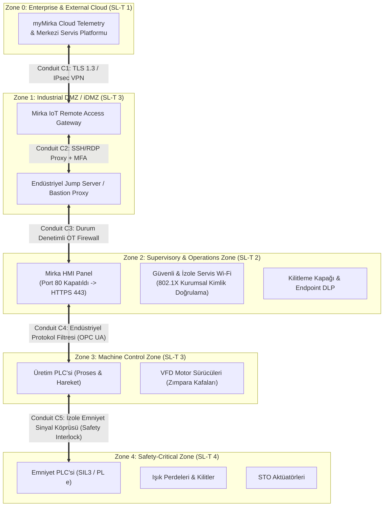

# 🛡️ Laboratuvar 2: IEC 62443 Mini Workshop (Zone & Conduit Mimarisi)
**Ders:** Yazılım Mühendisliğinde Güncel Konular (Safety 4.0 & Cyber-Physical Systems)  
**Şirket:** Mirka (Oy Mirka Ab)  
**İncelenen Makine:** Mirka Smart WoodSander 5000 — Endüstriyel Ahşap Zımpara Makinesi  
**Çıktı Belgesi:** Zone / Conduit Diagram *(Evidence Pack EP 05 Zone & Conduit)*  
**Tarih / Versiyon:** 2026-Q4 / v1.0  

---

## 📌 1. Amaç ve Temel Kavramlar

Endüstriyel Otomasyon ve Kontrol Sistemleri (IACS) güvenliği standardı olan **IEC 62443-3-2** uyarınca:
* **Zone (Güvenlik Bölgesi):** Benzer güvenlik gereksinimlerine, fonksiyonel kritiklik seviyesine (Security Level - Target: SL-T) ve fiziksel/mantıksal sınırlara sahip varlıkların mantıksal kümesidir.
* **Conduit (Güvenlik Kanalı):** İki farklı bölge (Zone) arasındaki veri ve sinyal akışını taşıyan, üzerinde sıkı güvenlik kontrolleri, durum denetimli güvenlik duvarları (Firewall) ve yetkilendirme kuralları barındıran korumalı geçit yoludur.

---

## 📋 2. İncelenen Varlık Listesi ve Güvenlik Açıkları

1. **Üretim PLC (Siemens S7-1500 / Beckhoff):** Ahşap besleme, zımpara kalınlık ayarı, tabla yüksekliği.
2. **Emniyet PLC'si (Safety PLC - SIL 3 / PL e):** Işık perdesi, kilitli kapak, acil durdurma, STO kontrolü.
3. **HMI Paneli (Dokunmatik Ekran):** Port 80 HTTP web arayüzü ve VNC açık (şifresiz haberleşme riski!).
4. **Motor Sürücüleri (VFD):** Yüksek hızlı zımpara kafaları ve besleme motorları (Modbus TCP / EtherCAT).
5. **Uzak Bakım Modülü (Mirka Telematics Gateway):** İnternete doğrudan açık 4G/LTE yönlendirici.
6. **Bulut Telemetri (myMirka Cloud):** Zımpara aşınması, titreşim ve enerji tüketim verisi aktarımı.
7. **Atölye Wi-Fi AP:** WPA2-PSK parolası makinenin yanındaki panoda kartona yazılmış!
8. **2 Kilitsiz USB Portu:** Biri HMI ön panelinde, biri elektrik panosunda yerel güncelleme ve log alma için açık.
9. **"admin/admin" Servis Hesabı:** Fabrika çıkışı varsayılan, tüm bileşenlerde ortak kullanılan ayrıcalıklı hesap.

---

## 🏗️ 3. Görev A — Varlıkları Bölgelere (Zones) Ayırma

### 1. Bölge Gruplandırması ve Hedef Güvenlik Seviyeleri (SL-T)

* **Zone 0 (Enterprise & Dış Bulut - SL-T 1):** myMirka Bulut telemetri sunucuları. İnternet dünyası.
* **Zone 1 (Endüstriyel DMZ - iDMZ - SL-T 3):** Uzak Bakım Modülü, Jump Server / Bastion Host. Doğrudan fabrika ağına veya makineye geçişi engelleyen tampon bölge.
* **Zone 2 (Operasyon & Denetim Bölgesi - SL-T 2):** HMI Operatör Paneli, yetkilendirilmiş teknisyen Wi-Fi ağı, kontrollü USB yönetim modülü.
* **Zone 3 (Makine Kontrol Bölgesi - SL-T 3):** Üretim PLC'si, Frekans Dönüştürücüler (VFD), konveyör tahrikleri.
* **Zone 4 (Güvenlik Kritik Bölge / Safety Zone - SL-T 4):** Emniyet PLC'si, Emniyet I/O modülleri, OSSD ışık perdeleri, çift kanallı E-Stop devreleri, STO hatları.

---

### 2. Açık Uzak Bakım Modülü Hangi Bölgeye Düşüyor — Orada Kalabilir mi? Neden?
* **Mevcut Durum Analizi:** Mevcut mimaride uzak bakım modülü, doğrudan üretim kontrol ağına (Zone 3) ve HMI'a (Zone 2) köprülenmiş vaziyettedir.
* **Orada Kalabilir mi?** **KESİNLİKLE HAYIR!**
* **Neden?**
  1. İnternete doğrudan açık bir cihazın üretim ağıyla (Zone 3) aynı fiziksel ve mantıksal broadcast domain'de bulunması, saldırganın tek bir zafiyetle (örn. uzaktan kod yürütme - RCE) doğrudan zımpara motorlarını ve PLC bellek haritasını ele geçirmesine imkan verir.
  2. Mirka bakım modülü derhal **Zone 1 (iDMZ)** içine hapsedilmelidir. Çift ağ kartlı (dual-homed) bir mimari ile dış dünya ile iç ağ arasında doğrudan IP yönlendirmesi (IP forwarding) engellenmeli, tüm trafik sadece proxy/jump server üzerinden akmalıdır.

---

### 3. Bölgeler Arası Geçişler (Conduit) Nerede? Her Geçişte Ne Kontrol Edilecek?

| Conduit | Bağlanan Bölgeler | Denetlenecek Protokol & Güvenlik Kontrolleri |
| :--- | :--- | :--- |
| **Conduit C1** | Zone 0 (Bulut) $\leftrightarrow$ Zone 1 (iDMZ) | **Protokol:** Dışarıdan içeriye başlatılan bağlantılar YASAK. Sadece içeriden dışarıya şifreli **IPsec / TLS 1.3** tüneli açılabilir. Durum denetimli paket analizi (Stateful Inspection), IDS/IPS devrede. |
| **Conduit C2** | Zone 1 (iDMZ) $\leftrightarrow$ Zone 2 (HMI / Denetim) | **Protokol:** Yalnızca Jump Server üzerinden RDP/SSH. **MFA zorunluluğu**, tam ekran oturum kaydı, kopyala-yapıştır (clipboard) dosya transfer engeli. |
| **Conduit C3** | Zone 2 (HMI) $\leftrightarrow$ Zone 3 (Üretim Kontrol) | **Protokol:** Yalnızca şifreli **OPC UA (Sign & Encrypt)** ve belirlenmiş S7CommPlus portları. Port 80 HTTP kesinlikle engellenir (HTTPS 443 zorunlu). Derin paket inceleme (DPI) ile yalnızca okuma/yazma yetkisi verilen değişken bloklarına izin verilir. |
| **Conduit C4** | Zone 3 (Üretim) $\leftrightarrow$ Zone 4 (Emniyet) | **Protokol:** Deterministik Safety Protokolü (PROFIsafe). Yalnızca read-only emniyet durumu (örneğin ışık perdesi ihlal edildi bilgisi) okunabilir. Emniyet programlama/konfigürasyon portları ağdan tamamen izole edilmiştir ve panodaki fiziksel **Safety Key Switch** çevrilmeden erişilemez. |

---

## 🔒 4. Görev B — Uzak Erişim Karar Tablosu (6 Satır)

Mirka Ahşap Zımpara Makinesi için siber güvenli uzak servis mimarisi kararları:

| Karar Alanı | Seçenekler | Uzman Seçiminiz ve Gerekçesi (Neden?) |
| :--- | :--- | :--- |
| **1. Aracı?** | Doğrudan / **Jump server** | **Seçim: Jump Server (Bastion Host).** *Gerekçe:* Dışarıdaki bir servis mühendisinin doğrudan PLC veya sürücüye IP seviyesinde bağlanması ölümcül risktir. Jump server tüm trafiği izole eder, kötü amaçlı yazılımların iç ağa sıçramasını engeller. |
| **2. Tünel?** | Açık / **VPN** | **Seçim: Çift Katmanlı Şifreli VPN (WireGuard / IPsec).** *Gerekçe:* Şifresiz açık internet trafiği dinlenebilir ve ortadaki adam (MitM) saldırısıyla manipüle edilebilir. Uçtan uca şifreli VPN tüneli veri gizliliği ve bütünlüğünü şart koşar. |
| **3. Kimlik?** | Parola / **MFA** | **Seçim: MFA (Çok Faktörlü Kimlik Doğrulama - FIDO2 / TOTP).** *Gerekçe:* Parolalar sızdırılabilir, unutulabilir veya kaba kuvvetle kırılabilir. Fiziksel donanım anahtarı veya zaman bazlı tek kullanımlık kod olmadan bağlantı kurulamaz. |
| **4. Hesap?** | Paylaşılan / **Kişisel** | **Seçim: Kişisel ve Rol Tabanlı Hesap (RBAC).** *Gerekçe:* "admin/admin" gibi ortak hesaplar sorumluluk ilkesini (non-repudiation) yok eder. Her Mirka servis mühendisinin adı-soyadı belli, süreli ve kişisel hesabı olmalı; olay anında kimin ne yaptığı net bilinmelidir. |
| **5. Kayıt?** | Yok / **Tam oturum kaydı** | **Seçim: Tam Oturum Kaydı (Video + Keystroke Logging).** *Gerekçe:* Uzaktan yapılan her tıklama, gönderilen her komut ve değiştirilen her parametre zaman damgalı olarak değiştirilemez (WORM) log sunucusuna kaydedilmelidir. |
| **6. Zamanlama?** | Sürekli açık / **Varsayılan kapalı** | **Seçim: Varsayılan Kapalı (On-Demand / Just-In-Time).** *Gerekçe:* Uzak erişim sürekli açık kalamaz. Yalnızca fabrikadaki operatör zımpara makinesi kontrol panosundaki **"Fiziksel Uzak Bakım Anahtarı"nı (Physical Key)** çevirdiğinde ve bakım talebi onaylandığında 2 saatliğine açılır, süre bitince otomatik kilitlenir. |

---
*Çıktı Kontrolü: Bu çalışma Zone/Conduit Diagram gereksinimlerini eksiksiz karşılayarak **Evidence Pack EP 05 Zone & Conduit** portföyüne aktarılmıştır.*
