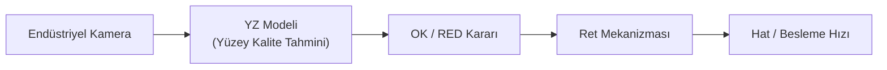

# 🤖 Laboratuvar 7: AI Safety Challenge (Yapay Zekâ Destekli Kalite Kontrol ve Fail-Safe Tasarımı)
**Ders:** Yazılım Mühendisliğinde Güncel Konular (Safety 4.0 & Cyber-Physical Systems)  
**Bölüm:** 2.2 Paketleme Föyleri *(Kendi Makinemiz İçin Uyarlama)*  
**Şirket:** Mirka (Oy Mirka Ab)  
**İncelenen Makine:** Mirka Smart WoodSander 5000 — Endüstriyel Ahşap Zımpara Makinesi  
**Çıktı Belgesi:** AI Fail-Safe Decision *(Evidence Pack EP 03 + EP 15)*  
**Tarih / Versiyon:** 2026-Q4 / v1.0  

---

## 📌 1. Kavram ve Mimari Senaryo

* **Temel Kavram — Prediction ≠ Safety:** Yapay zekâ (YZ) olasılıksal bir tahmin/karar üretir; **insan ve makine güvenliğini garanti eden mimari ise YZ'nin dışında, deterministik olarak tanımlanmalıdır.**
* **Araçlar:** `fail-safe` · `human override` · `monitoring` · `confidence threshold` · `fallback`
* **Senaryo:** Mirka Smart WoodSander 5000'e **YZ destekli görsel yüzey kalite kontrolü** (ahşap yüzeyde çizik, yanık izi, düzensiz zımpara tespiti) ve buna bağlı otomatik ret/ayarlama mekanizması eklenmesi planlanmaktadır.

> 🛡️ **Altın Tasarım İlkesi:** YZ yalnızca **kalite kararı** verir; zımpara kafası kilidi, bakım kapağı kilidi, ışık perdesi ve STO gibi **emniyet (safety) fonksiyonlarına hiçbir komut yetkisi yoktur.**

---

## 🛠️ 2. Görev — Üç Başarısızlıkta Güvenli Davranış

### 1. Model Yanlış Sınıflandırdı: Kusurlu parçaya "OK" verdi. Sistem ne yapmalı? İkinci kontrol / insan onayı var mı?
* **Analiz ve Güvenli Davranış:** Kalite hatası doğrudan bir emniyet olayı değildir ancak kontrol zinciri korunmalıdır:
  1. **Bağımsız İkinci Kontrol:** Yapay zekâ dışı deterministik sensör (örn. lazer kalınlık / yüzey pürüzlülük sensörü) ve periyodik/örneklemeli **insan kontrolü (human-in-the-loop)** uygulanır.
  2. **Hata Oranı İzleme (Monitoring):** Kaçak/hata oranı belirlenen eşiği aşarsa YZ otomatik olarak devre dışı bırakılır ve tam manuel kontrole dönülür (`human override`).
  3. **Yetki Sınırı:** YZ kararı hiçbir zaman makine emniyetini veya zımpara/besleme hızını tek başına tehlikeli sınırlara değiştiremez.

---

### 2. Girdi Manipüle Edildi: Kamera verisi bozuk/sahte. Nasıl fark edilir? Şüpheli girdide ne yapılır?
* **Nasıl Fark Edilir:**
  * Görüntü kalitesi ve aydınlatma kontrolü (ahşap tozu lekesi, bulanıklık, kapalı lens tespiti),
  * Kare sayısı (FPS), zaman damgası (timestamp) ve video akış bütünlüğü kontrolü,
  * Kamera kimlik doğrulama ve imzalı/izole ağ iletişimi,
  * Ani istatistiksel dağılım kayması ve beklenen ahşap panel geometrisi ile tutarsızlık.
* **Şüpheli Girdide Ne Yapılır:**
  * YZ kararı **kesinlikle kullanılmaz** → Parça varsayılan olarak **"Belirsiz / RED"** olarak ayrılır (`fail-safe`), insan kontrolüne yönlendirilir ve operatöre alarm verilir.
  * Durum tekrarlarsa hat güvenli ve kontrollü şekilde durdurulur ve siber olay kaydı açılır (bkz. Laboratuvar 6).

---

### 3. Confidence (Güven Skoru) Düştü: Model "emin değilim" diyor. Eşik ne olmalı? Altında: dur / insana sor / fallback?
* **Örnek Eşik Kurgusu (Pilot çalışma sonucu kalibre edilmelidir):**
  * **Güven Skoru ≥ %90:** Otomatik karar (`OK` / `RED` ayırma devam eder).
  * **Güven Skoru %70 – %90 Arası:** **İnsana Sor** (Parça yan inceleme hattına alınır, operatör onayı beklenir).
  * **Güven Skoru < %70 (veya art arda N parça belirsiz):** **Fallback** (Klasik kural tabanlı/manuel kontrole geçiş) uygulanır ve üretim hattı kontrollü olarak yavaşlatılır veya durdurulur.
* Eşik kalibrasyonu gerçek hata maliyetine göre test verisiyle yapılır ve modeldeki sessiz performans düşüşü (**data/model drift**) sürekli izlenir.

---

## 📊 3. Karar Tablosu — AI Fail-Safe Decision

| Başarısızlık Senaryosu | Tanımladığınız Güvenli Davranış (Hangi Kavramla?) |
| :--- | :--- |
| **Model yanlış sınıflandırdı** | Bağımsız ikinci kontrol (lazer sensör) + periyodik insan onayı; kaçak oranı eşiği aşarsa YZ devre dışı bırakılır, manuel kontrole dönülür. **(`human override` + `monitoring`)** |
| **Girdi manipüle edildi** | Girdi doğrulama başarısız → Parça doğrudan `"Belirsiz / RED"` ayrılır, insan kontrolü ve alarm devreye girer; tekrarında kontrollü durdurma uygulanır. **(`fail-safe` + `monitoring`)** |
| **Confidence düştü** | `≥ %90` otomatik karar; `%70–%90` insana sor; `< %70` durumunda klasik/manuel kontrole geçiş ve gerekirse kontrollü durdurma. **(`confidence threshold` + `fallback`)** |

---
*Çıktı Kontrolü: Bu föyün çıktısı **AI Fail-Safe Decision → Evidence Pack EP 03 + EP 15** başlığına oturur.*
