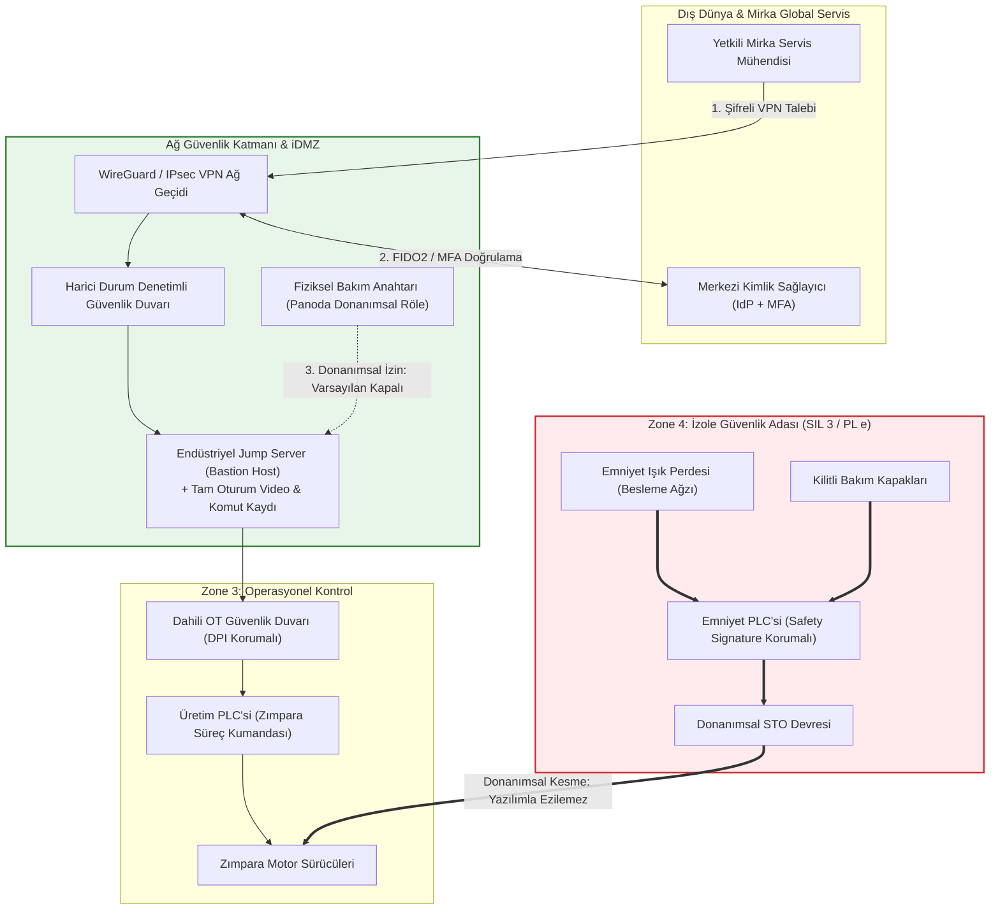

# 🔐 Laboratuvar 4: Secure Remote Access (Güvenli Uzak Erişim & Fonksiyonel Emniyet Köprüsü)
**Ders:** Yazılım Mühendisliğinde Güncel Konular (Safety 4.0 & Cyber-Physical Systems)  
**Şirket:** Mirka (Oy Mirka Ab)  
**İncelenen Makine:** Mirka Smart WoodSander 5000 — Endüstriyel Ahşap Zımpara Makinesi  
**Çıktı Belgesi:** Secure Architecture *(Evidence Pack EP 02 + EP 06)*  
**Tarih / Versiyon:** 2026-Q4 / v1.0  

---

## 📌 1. Amaç ve Temel İlke

Endüstriyel siber-fiziksel sistemlerde güvenli uzak erişim tek bir güvenlik duvarı kurmaktan ibaret değildir. İki katman aynı anda sağlanmalıdır ve ikisi de zorunludur:
1. **Erişim Güvenliği Katmanı (Hücresel Savunma):** Girişi en üst düzeyde zorlaştır, şifrele, yetkilendir ve kayıt altına al (Ara nokta, VPN, MFA, kişisel hesap, oturum kaydı, varsayılan kapalı).
2. **Emniyet Bağımsızlığı Katmanı (Functional Safety Independence):** Saldırgan tüm siber barikatları aşıp kontrol ağına kök yetkisiyle girse bile, **makine başında çalışan insan fiziksel ve donanımsal olarak korunmalıdır!**

---

## 🏗️ 2. Görev A — Mevcut Mimari vs. Hedef Güvenli Mimari

### Mevcut Durum (As-Is Architecture) — ⚠️ Zafiyetli ve Tehlikeli
* **Durum:** Mirka IoT Uzak Bakım Modülü, harici bir 4G/LTE anteni veya doğrudan fabrikadaki kurumsal internete bağlanarak dış dünyaya açıktır.
* **Topoloji:** Uzak bakım cihazı ile Normal PLC, Motor Sürücüleri ve HMI paneli aynı Ethernet switch üzerinde, ayrıştırılmamış tek bir düz ağda (flat network) yer almaktadır.
* **Erişim Modeli:** Dışarıdan doğrudan IP yönlendirmesi (port forwarding) ile PLC portlarına (örn. port 102 veya 502) ve HMI'ın şifresiz Port 80 HTTP arayüzüne bağlantı açıktır.
* **Hesap:** Tek bir fabrikasyon "admin/admin" parolası tüm teknisyenler tarafından ortaklaşa kullanılmaktadır. Oturum kaydı tutulmamaktadır ve bağlantı haftanın 7 günü 24 saat kesintisiz açıktır.

---

### Hedef Mimari (To-Be Architecture) — 🛡️ Beş İlkeyle Güvenli Yeniden Tasarım

#### Beş İlkenin Uygulanması:
1. **Ara Nokta (Jump Server / Bastion Host):** Dışarıdaki mühendis asla PLC veya sürücüye doğrudan IP seviyesinde bağlanamaz. Tüm etkileşim iDMZ içindeki Jump Server üzerinde sonlandırılır.
2. **Kriptografik Tünel (VPN - WireGuard / IPsec):** Şifresiz ve açık bağlantılar engellenir; tüm veri paketi akışı TLS 1.3 ve güçlü simetrik/asimetrik şifrelemeyle korunur.
3. **MFA ve Kişisel Hesap (Zero Trust RBAC):** "admin/admin" gibi ortak hesaplar tamamen silinir. Her mühendis kendi kişisel kurumsal kimliği ve donanımsal FIDO2 anahtarı / TOTP ile doğrulanır.
4. **Tam Oturum Kaydı ve Denetim İzi:** Uzak oturum süresince ekranda yapılan her işlem video formatında ve klavye/komut düzeyinde zaman damgalı olarak değiştirilemez SIEM sunucusuna kaydedilir.
5. **Varsayılan Kapalı ve Fiziksel İzin (Just-In-Time & Physical Key):** Uzak erişim sürekli kapalıdır. Yalnızca makine başındaki yetkili operatör panodaki **"Uzak Bakım İzin Anahtarı"nı (Physical Hardwired Key)** çevirdiğinde ağ kartının enerjisi verilir ve zaman sınırlı (örn. 2 saat) bir bakım penceresi açılır.

---

## 🌉 3. Görev B — Functional Safety Köprüsü

### Soru 1: Saldırgan tüm önlemlere rağmen içeri girerse: Emniyet fonksiyonu etkilenir mi? Neden?
* **Cevap:** **HAYIR, ETKİLENMEZ VE KESİNLİKLE ETKİLENMEMELİDİR.**
* **Neden (Mühendislik Gerekçesi):**
  * Mirka Smart WoodSander 5000'de **"Fonksiyonel Emniyet Bağımsızlığı (Independence of Safety)"** ilkesi uygulanmıştır.
  * Zımpara motorlarını durduran emniyet ışık perdesi ve acil durdurma devreleri, Normal PLC veya Uzak Bakım Modülü üzerinden yazılımsal olarak yürütülmez.
  * Bu sinyaller, ayrı bir TÜV onaylı **Safety PLC** ve motor sürücülerinin donanımsal **STO (Safe Torque Off)** terminalleri üzerinden doğrudan optik/röle tabanlı çift kanal (1oo2) mantığıyla çalışır.
  * Bir saldırgan Normal PLC'nin tüm kontrol kodunu silse, hafızasını tersyüz etse veya HMI'ı kilitlese bile; bir operatör elini besleme ağzındaki ışık perdesinden içeri uzattığı anda OSSD yarı iletken çıkışları milisaniyeler içinde enerjisiz kalır, STO devresi motorların manyetik alan enerjisini donanımsal olarak keser ve mekanik yaylı frenler zımparayı durdurur. Siber alemdeki hiçbir yazılım komutu bu fiziksel açma eylemini engelleyemez.

---

### Soru 2: Işık perdesi zincirinin uzak bakım yolundan etkilenmemesi için GEREKSİNİMİ yazın (Çözümü değil).

> 📋 **Sistem Emniyeti ve Siber Güvenlik Gereksinimi (Safety-Security Requirement SRS-042):**  
> *"Besleme ağzı emniyet ışık perdesi güvenlik fonksiyonunun (optik ihlal algılandığında zımpara tahriklerinin ve tehlikeli hareketlerin azami 150 milisaniye içinde torksuz bırakılarak Safe State durumuna geçirilmesi ve durdurulması); harici haberleşme ağlarının, uzak servis/bakım kanallarının, standart proses kontrol yazılımının veya işletim sisteminin çalışma modundan, ağ bağlantı durumundan, uğrayabileceği veri/kod bozulmalarından veya yetkisiz yazılımsal müdahalelerden **tamamen bağımsız ve deterministik olarak icra edilmesi ZORUNLUDUR**."*

---
*Çıktı Kontrolü: Bu föyün çıktısı Secure Architecture prensiplerini eksiksiz karşılayarak **Evidence Pack EP 02 (Architecture) + EP 06 (Remote Maintenance)** başlıklarına oturur.*
